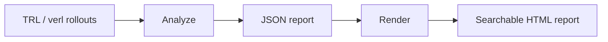

# Rollout Diff

Rollout Diff uses deterministic analysis to detect behavioral shifts across RL training steps. Its ranked reports connect changes in generated code and prose to supporting evidence and selected responses from your rollout dump.



## Setup

Use Python 3.11 or newer. Pinned benchmark references use Python 3.12+.

```sh
python -m venv .venv
.venv/bin/python -m pip install -e '.[test]'
```

With `uv`, install into the existing environment:

```sh
uv pip install --python .venv/bin/python -e '.[test]'
```

## Usage

### Analyze and render

Analyze TRL completions and render the saved report as searchable HTML:

```sh
.venv/bin/rolloutdiff analyze /path/to/completions --format trl --run experiment-1 \
  --reward-column training_passed --output /path/to/report.json

.venv/bin/rolloutdiff render /path/to/report.json --output /path/to/report.html
```

For verl dumps, use `--format verl` and omit `--reward-column`. Reports contain event evidence and exemplar references, with raw response text kept in the original dump. Choose a fresh output path each time.

### Inspect an event

Inspect the selected responses for the highest-ranked event:

```sh
.venv/bin/rolloutdiff inspect /path/to/completions --format trl --run experiment-1 \
  --reward-column training_passed --report /path/to/report.json --event-rank 1
```

Add `--with-absent` to compare binary-feature examples with feature-absent completions from the same run, step, and prompt. Supply complete groups so reward summaries include every completion. Groups with no absent completion receive an unavailable comparison status.

Inspection checks saved identities and metadata. Version-1 reports have no response fingerprint.

### Python API

```python
from rolloutdiff import analyze_rollouts, load_trl

rollouts = load_trl(
    "/path/to/completions", run="experiment-1", reward_column="training_passed"
)
analysis = analyze_rollouts(rollouts)
print(analysis.event_ranking)
print(analysis.evidence)
```

`analysis.evidence` covers every extracted feature series plus `scalar:reward`. Use `build_report(analysis)` and `render_report(report)` to create reports in Python, or `resolve_exemplars()` to retrieve selected responses.

### Aria replay

Replay a selected Aria completion in disposable Docker containers. This executes generated code and requires the supported Python image installed locally, along with the pinned evaluator and task artifacts.

Set `RESPONSE_SHA256` to the selected response's SHA-256 hash.

```sh
.venv/bin/rolloutdiff replay-aria /path/to/aria.parquet --run aria \
  --sample-id step111_row233 --response-sha256 "$RESPONSE_SHA256" \
  --artifacts /path/to/pinned-artifacts --docker-host unix:///var/run/docker.sock \
  --allow-execution --output /path/to/replay.json
```

The JSON result includes host-side task-test comparisons and historical evaluator claims marked as untrusted.

## Inputs

| Loader | Accepted input |
| :--- | :--- |
| `load_trl` | Completions directory, trainer output directory, or `completions_<step>.parquet` |
| `load_verl` | Rollout directory, `<step>.jsonl`, or `step_<step>.jsonl`, optionally gzipped |
| `from_table` | DataFrame, with source-column mapping through `columns` |

TRL uses `reward` by default or a specified `reward_column`. The verl adapter maps `input`, `output`, `score`, and `step`. Custom reward functions can change what `score` represents.

Canonical rows contain `run`, `step`, `sample_id`, `prompt_id`, `prompt`, `response`, and `reward`. Each `(run, sample_id)` pair must be unique, with a nonnegative integer step and a finite reward. Use explicit sample IDs when reordering source rows. A `prompt_id` identifies exact prompt content within a run, including chat roles and metadata.

## Reading the results

Completions are averaged within each prompt, then prompts receive equal weight at each step. At least two sampling units are needed to estimate standard errors. Related prompts can share a unit through the optional `sampling_units` mapping.

Sequential detection uses the first 15 observed steps as its baseline and requires three consecutive qualifying observations in the same direction. Retrospective detection looks for a single mean shift across the run. See [`detect.py`](src/rolloutdiff/detect.py) and [`retrospective.py`](src/rolloutdiff/retrospective.py) for thresholds and statistical details.

Event ranks provide a heuristic inspection order. Evidence for sequential alerts covers replication, persistence, reward association, and prompt mix. Check availability statuses and numerical-floor warnings when interpreting a result.

Error rates are uncalibrated. Vocabulary selection uses the complete run, and public benchmark targets were chosen after inspecting the runs. Causal and mechanism claims require independent evidence.

## Development

```sh
.venv/bin/python -m pip install -c .github/ci-constraints.txt ruff
.venv/bin/ruff format --check src bench tests
.venv/bin/ruff check src bench tests
.venv/bin/python -m pytest -q -m 'not local_data'
```

See [`bench/`](bench/) for public-run and synthetic benchmarks, and [`tests/`](tests/) for local-data checks. Keep datasets and generated outputs outside the repository. Aria and TRL redistribution permissions remain unresolved.
