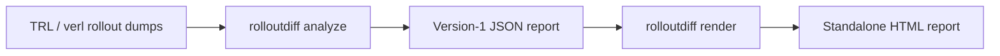

# Rollout Diff

Deterministic analysis of behavioral shifts across RL training, covering rollout ingestion, static feature extraction, prompt-balanced aggregation, change detection, and supporting evidence.

## Setup

Requires Python 3.11+.

```sh
python -m venv .venv
.venv/bin/python -m pip install -e '.[test]'
```

For `uv` environments without `pip`, install into the existing virtual environment with:

```sh
uv pip install --python .venv/bin/python -e '.[test]'
```

## Usage

### Python API

```python
from rolloutdiff import analyze_rollouts, load_trl

rollouts = load_trl(
    "/path/to/completions", run="experiment-1", reward_column="training_passed"
)
analysis = analyze_rollouts(rollouts)
print(analysis.evidence)
print(analysis.sequential.screening)
print(analysis.exemplars)
print(analysis.events)
print(analysis.event_members)
print(analysis.event_ranking)
```

`analysis.evidence` contains one row per extracted feature series plus `scalar:reward`, including non-alerting and unscorable series.

### CLI and reporting

```sh
.venv/bin/rolloutdiff analyze /path/to/completions --format trl --run experiment-1 \
  --reward-column training_passed --output /path/to/report.json
```

Pass `--format verl` (and omit `--reward-column`) to analyze verl dumps. The versioned JSON report stores ranked events, member-level evidence, and canonical exemplar references while omitting raw rollout text and input file paths. Python callers can build the same payload via `build_report(analysis)` without writing a file. Report export rejects recognizable absolute filesystem paths within identifiers, and CLI output files are never overwritten.

```sh
.venv/bin/rolloutdiff render /path/to/report.json --output /path/to/report.html
```

`render` writes a self-contained local HTML file from the saved JSON report without rerunning analysis. Python callers can use `render_report(report)` to obtain the HTML text. The view provides searchable ranked events alongside expandable evidence and exemplar references. The CLI refuses to overwrite existing files.

```sh
.venv/bin/rolloutdiff inspect /path/to/completions --format trl --run experiment-1 \
  --reward-column training_passed --report /path/to/report.json --event-rank 1
```

`inspect` resolves a saved event's selected exemplars against the original dump and prints responses locally with terminal controls escaped. It checks exact `(run, sample_id)` identity, step, prompt ID, and reward without rerunning analysis. Python callers can use `resolve_exemplars(report, rollouts, run="experiment-1", event_rank=1)` to obtain an event copy with a `response` field on each exemplar, or `None` for unselected records. Missing records and unsupported statuses remain explicit. Version 1 has no response fingerprint, so these checks cannot establish that the text is unchanged.

Pass `--with-absent` (`with_absent=True` in Python) to attach a within-group `comparison` to each exemplar. For selected binary exemplars, inspection verifies feature presence and pairs each exemplar with a feature-absent completion from the same run, step, and prompt, selecting the lexically smallest sample ID regardless of reward. Summary statistics (counts, group mean rewards, and present-minus-absent difference) are computed over the full group. Supply complete groups; saved group sizes are checked when available. When every completion has the feature, the comparison is marked unavailable.



### Loaders

| Loader | Accepted input | Schema mapping |
| :--- | :--- | :--- |
| `load_trl` | Completions directory, trainer output directory, or `completions_<step>.parquet` | Reads `reward_column` when specified or defaults to `reward` (TRL may log separate columns per reward function without a total column). Fails on `NaN` rewards. |
| `load_verl` | Rollout directory, `<step>.jsonl`, or `step_<step>.jsonl` (optionally `.gz`) | Maps `input`, `output`, `score`, and `step` (verified against a verl 0.9.1 shard). `score` equals the summed `token_level_scores` unless the reward function returns a custom `score` (DAPO's score omits the overlong penalty). |
| `from_table` | DataFrame | Maps canonical column names to source columns through the `columns` dictionary. |

## Input contracts

* Every row requires `run`, a nonnegative integer `step`, `sample_id`, `prompt_id`, `prompt`, `response`, and a finite `reward`. Each `(run, sample_id)` pair must be unique, and unsupported message content fails validation.
* `prompt_id` identifies exact prompt content within a run, including chat roles and metadata. Automatically generated `sample_id` values depend on the source name and row position, so callers should pass explicit IDs when rows may be reordered.
* Features belong to a tier (`structural` or `prose`) and a kind (`binary` or `continuous`). The extractor strips complete `<think>` and `<thinking>` blocks before parsing Python fragments statically without code execution. Because Python 3.11 rejects backslashes inside f-string expressions (PEP 701), affected fragments set `code_parse_fail` and contribute no AST features on 3.11. Pinned local reference values assume Python 3.12+.
* Vocabulary selection scans the full dataset, retaining up to $2{,}000$ sparse features per tier that reach $`\ge 5\%`$ prompt-balanced prevalence at any `(run, step)`.

## Aggregation and uncertainty

At each step, the aggregator averages completions within each unique `prompt_id` first and weights prompts equally, treating absent sparse features as $0$. An optional `sampling_units` DataFrame maps each `(run, prompt_id)` to a `sampling_unit_id` (defaulting to one unit per prompt). Sampling units cluster the standard errors and keep related prompts together during split-half replication without altering point estimates.

For $P$ prompt means $x_p$ with overall mean $\mu$ partitioned across $U$ sampling units, the CR1 standard error is:

$$S_u = \sum_{p \in u} (x_p - \mu), \qquad \text{SE} = \frac{1}{P}\sqrt{\frac{U}{U - 1} \sum_{u=1}^{U} S_u^2}$$

Steps with $U < 2$ have an unavailable $\text{SE}$.

## Change detectors

**Sequential (`detect_sequential`)**: Freezes the baseline mean and $\text{scale} = \max(\text{baseline SD}, \text{median baseline SE}, 10^{-9})$ over the first $B = 15$ observed steps. Raising an alert requires $3$ consecutive logged steps in the same direction with $|z| > 4$ for continuous features, or $z > 4$ alongside a prevalence increase of $\ge 0.10$ for binary features. Missing baseline $\text{SE}$ values mark a series unscorable, and missing monitoring $\text{SE}$ values reset the current streak. Baselines whose measured SD and median SE are both at or below the numerical floor receive the `numerical_floor_dominant` flag. Alerts dominated by this floor can change with the chosen measurement units.

**Retrospective (`detect_retrospective`)**: Fits the single minimum-SSE $L_2$ mean-shift split (with $\ge 5$ steps per segment and `changepoint_step` marking the start of the right segment) and selects it when:

$$\text{SSE}_{\text{null}} - \text{SSE}_{\text{split}} > 3 \log(n) \cdot \max\left(\frac{\text{SSE}_{\text{split}}}{n - 2}, \text{mean}(\text{SE}^2)\right)$$

with an absolute shift of $\ge 0.10$ for binary features or $\ge 0$ for continuous features. Under the default `dependence="ar1"`, the detector retains the split only when profiling a stationary AR(1) covariance plus measurement variance separately under the constant-mean and split-mean models yields $2\Delta\ell > 3 \log(n)$ with a matching GLS shift direction. Exact piecewise-constant splits with zero $\text{SE}$ remain selected with `covariance_status` set to `exact_zero_variance_unconfirmed`. Binary series containing a mixed step use quasi-binomial measurement variance $`\phi\, m(1-m)/U_t`$ at segment mean $m$, whereas all other series use measured $\text{SE}^2$. Any missing $\text{SE}$ marks the series unscorable.

## Supporting evidence

Supporting evidence is anchored to the sequential alert. Reward association evaluates the interval from streak onset through the alert step. Prompt mix compares that interval with the baseline window, and persistence evaluates subsequent steps. Series detected only by the retrospective test carry no anchored evidence.

| Metric | Definition | Edge cases |
| :--- | :--- | :--- |
| `split_half_replication` | First alerts from the full run and both whole-unit halves share one direction and span at most $10$ full-grid positions. | `contiguous_prefix` (default) halts at the first gap, while `fixed_window` resumes across gaps. An unavailable $\text{SE}$ that could mask an earlier alert marks that half unavailable. |
| `event_window_corroboration` | A $3$-step same-direction streak in both halves within $10$ full-grid positions of the full-run alert. | Either complete, scorable half without a matching streak establishes contradiction. Matching streaks in both halves can corroborate before the window is complete. Other outcomes remain unavailable. |
| `persistence` | Fraction of subsequent evaluable steps retaining $`\ge 50\%`$ of the alert-step shift. | Returns no estimate when no evaluable later step exists. |
| `reward_association` | Equal-weighted present-minus-absent reward difference across mixed `(run, step, prompt_id)` groups. | Continuous features return `not_binary`. |
| `prompt_mix` | Positive-prompt breadth and paired change across shared prompts between disjoint windows. | Paired change is unavailable when no prompts appear in both windows. Positive-prompt breadth remains measurable for binary features. |

### Sequential alert exemplars

`analysis.exemplars` (or `select_exemplars`) selects up to three distinct rollout references for rising binary alerts within the observed onset-to-alert window. Selection starts with the earliest feature-positive rollout, followed, when available, by the largest positive within-prompt, same-step reward deviation among remaining candidates in the alert window. Remaining selections prioritize prompt diversity and deterministic ID tie-breaking. Returning canonical `(run, sample_id)` references and selection metadata allows downstream tools to look up original responses without duplicating rollout text in the report. Unsupported or unavailable alerts produce explicit status rows. Exemplars provide concrete instances of feature presence in the alert window, leaving exploit verification and population representativeness outside scope.

### Sequential alert events

`analysis.events` clusters compatible sequential alerts into events, and `analysis.event_members` joins them to feature-level evidence and exemplars on `(run, feature)`.

`group_events()` uses deterministic first-fit grouping for rising binary alerts within each run. Onsets must be within $3$ numeric steps and positive-rollout Jaccard overlap must reach $0.5$ over the inclusive window from the earlier onset to the later alert, with every pair compatible. Unsupported or unavailable alerts remain singletons. Event IDs are local to each analysis. Group membership reflects temporal proximity and positive-rollout overlap. A shared cause remains unverified.

`analysis.event_ranking` (or `rank_events`) orders events within each run using the best single member's evidence, sorting by feature tier, split-half replication, persistence, signed reward association, and prompt breadth. Contextual and unavailable events remain in the table alongside their status flags and numerical-floor warnings.

## Limitations

* Error rates are uncalibrated, and lexical indicators, reward associations, and prompt-mix shifts are strictly descriptive. Event ranks prioritize inspection, and causal interpretation or mechanism attribution requires independent evidence.
* Vocabulary selection scans the complete run retrospectively, and the public benchmarks evaluate fixed targets chosen after inspecting the runs.
* Low sampling-unit counts increase $\text{SE}$ variance, and sparse baseline windows increase sequential scale variance.
* AR(1) confirmation can reduce both false alerts and small-shift sensitivity in fitted stationary-AR(1) scenarios (`bench.dependence_study` measures this tradeoff). The binary variance formula approximates sampling units as equally weighted, so unequal unit sizes can distort its measurement-variance estimate.
* The retrospective detector fits a single step-function shift. Transient excursions and outliers can affect its fitted boundary and shift.

## Benchmarks

Benchmark datasets and generated outputs remain outside the repository.

* `bench/public_manifest.json` pins $4$ dataset revisions and $118$ Parquet files by byte size and SHA-256 hash without downloading data automatically. While the AISI dataset cards specify Apache-2.0, the underlying problem prompts may carry separate terms, and licensing for the Aria and TRL dumps remains unresolved (avoid redistributing them). Benchmark preprocessing drops any step containing a missing reward or response in full (removing step $403$ from AISI2). Because the TRL run logs one prompt per step, all series have unavailable $\text{SE}$ and evaluation covers label attribution only. Passing `--external-root` to `bench.public_benchmark` runs the available pinned `rlprobe`, `rldoctor`, and `CHERRL`/`RHDA` baselines defined in `bench/external_manifest.json`.
* `bench.run_local` fits the first $15$ steps of Aria (plus AISI when `--public-root` is provided), injects $+0.20$ prevalence or $+2$ rollout-SD shifts at step $40$ of $80$, and evaluates each detector across pooled non-degenerate profiles within each source run. The benchmark target requires correct-direction detections within $5$ steps (by alert delay or boundary error) in $`\ge 95\%`$ of all generated planted trials, while flagging $`\le 0.5\%`$ of scorable stationary series.

```sh
# --verify-only checks file hashes and sizes without running analysis
.venv/bin/python -m bench.public_benchmark \
  --data-root /path/to/data --run aisi0 --verify-only --output /tmp/aisi0.json
.venv/bin/python -m bench.sparse_replication \
  --data-root /path/to/data --run aisi2 --output /tmp/halves.json
.venv/bin/python -m bench.run_local \
  --aria /path/to/aria.parquet --output /tmp/fitted.json
.venv/bin/python -m bench.dependence_study \
  --aria /path/to/aria.parquet --output /tmp/dependence.json
```

## Verification

```sh
.venv/bin/python -m pip install -c .github/ci-constraints.txt ruff
.venv/bin/ruff format --check src bench tests
.venv/bin/ruff check src bench tests
.venv/bin/python -m pytest -q -m 'not local_data'

# Local data for the full test suite and acceptance checks
export ROLLOUTDIFF_ARIA_PATH=/path/to/aria.parquet \
  ROLLOUTDIFF_FULL_ARIA=1 \
  ROLLOUTDIFF_TRL_DIR=/path/to/trl_sunshine \
  ROLLOUTDIFF_PUBLIC_ROOT=/path/to/data \
  ROLLOUTDIFF_VERL_SHARD=/path/to/step_000001.jsonl.gz \
  ROLLOUTDIFF_EXTERNAL_SOURCES=/path/to/snapshots
.venv/bin/python -m pytest -q

# Acceptance checks
.venv/bin/python -m pytest -q -m local_data tests/test_aria_full_pipeline.py tests/test_public_runs.py \
  -k "acceptance or named_target or detection_unscorable"
```

The acceptance checks run as standard `pytest` assertions. `test_local_retrospective_meets_synthetic_acceptance` fails when the retrospective detector misses its synthetic benchmark thresholds.
